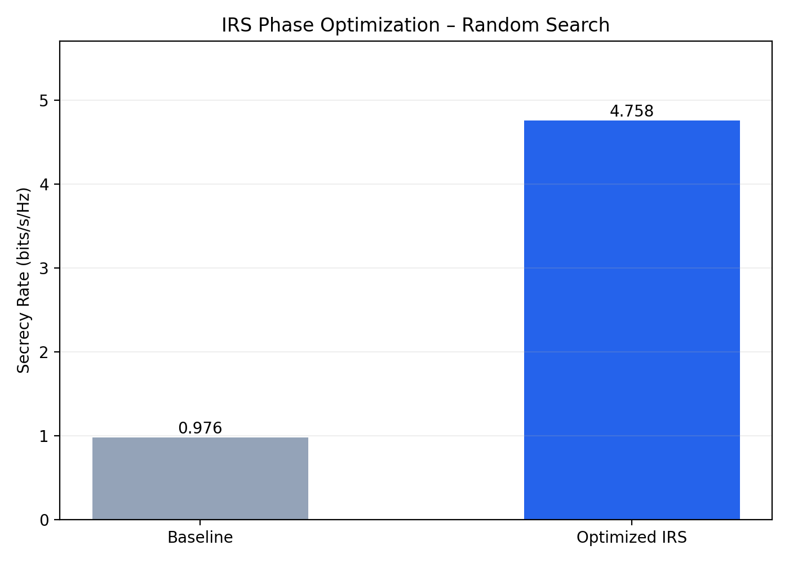

# Mobile Eavesdropper Tracking — Python Reconstruction

An **independent educational reconstruction** inspired by the themes of my MSc thesis, *Physical Layer Security Analysis with a Mobile Eavesdropper in the Presence of Reconfigurable Intelligent Surfaces* (Shahid Beheshti University, 2025).

## Scope

This initial project simulates a two-dimensional Brownian random walk for a mobile eavesdropper and uses a discrete linear Kalman filter to estimate position from noisy observations. It plots the actual trajectory, noisy measurements, and filtered estimates.

**Important:** This is newly written demonstration code, **not** the original MATLAB thesis implementation. Its parameters and numerical results are illustrative and **do not reproduce or validate** the thesis results. The model is a simplified position-only random walk, not a complete wireless propagation or IRS security simulation. No IRS phase optimization, artificial-noise power allocation, or secrecy-rate calculation is implemented yet.

## Run

Requires Python 3.10+.

```bash
python -m pip install -r requirements.txt
python -m src.simulation
python -m unittest discover -s tests -v
```

The plot is saved to `results/trajectory.png`. The terminal reports observation and filtered position RMSE for the illustrative scenario.

## Next steps

- Document the specific motion and observation assumptions against the thesis model.
- Add Monte Carlo experiments across noise levels and seeds.
- Independently implement a clearly scoped secrecy-rate / IRS example after verifying equations and permission to reuse thesis-specific material.

## Academic context

The thesis studied physical-layer security in the presence of a mobile eavesdropper, using location estimation, reconfigurable intelligent surfaces, artificial noise, and optimization. This repository currently demonstrates **only the tracking component**.


## IRS Phase Optimization

This project includes a simplified IRS phase optimization
simulation using Python and NumPy.

A random-search algorithm evaluates 2,000 candidate phase
configurations for a 16-element Intelligent Reflecting
Surface (IRS).

The objective is to maximize the simulated secrecy rate
by improving the legitimate receiver's channel relative
to the eavesdropper's channel.

### Simulation Results

| Metric | Value |
|---|---|
| Baseline secrecy rate | 0.9760 bits/s/Hz |
| Optimized secrecy rate | 4.7581 bits/s/Hz |
| Absolute improvement | 3.7820 bits/s/Hz |



### Model Limitations

This is a simplified, fixed-channel simulation using
random-search optimization.

It does not yet integrate mobile eavesdropper tracking,
artificial noise, or joint power and phase optimization.

The results are from a new educational implementation
inspired by the MSc thesis, not a reproduction of the
original thesis results.

